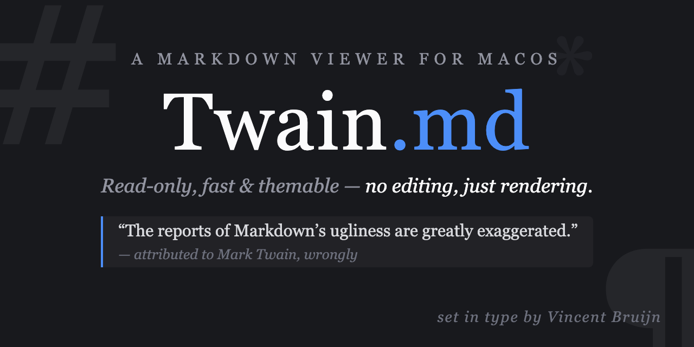

# The Adventures of a Markdown Document

*Being a truthful account of every element a viewer ought to render, told with only the customary amount of exaggeration.*

> "The difference between the almost right word and the right word is really a large matter — 'tis the difference between the lightning-bug and the lightning."
>
> — Mark Twain, who never saw a markdown file but would have had opinions about it

## Chapter I — In Which the Author States His Business

This here is a **test file** for the *Twain* markdown viewer, and I will thank you not to look for a moral in it. Persons attempting to find a plot will be shot, but persons finding a rendering bug will be thanked kindly and asked to file an issue.

The viewer claims the following virtues, and I have found no cause to doubt them:

- **Read-only** — it will not let you meddle with a document, which is more than can be said for most editors
- **Multiple windows** — for the reader of considerable ambition
- **Light and dark mode** — suitable for reading by day or by lantern
- **Fast rendering** — faster than a steamboat with a tailwind, which is to say:
  - fast on short documents
  - tolerably fast on long ones
  - and honest about it either way

## Chapter II — Concerning Machinery

I once knew a man who could read Swift the way a pilot reads the Mississippi. He is dead now, but the code lives on:

```swift
struct ContentView: View {
    var body: some View {
        Text("Hello, Twain!")
            .font(.title)
    }
}
```

***

## Chapter III — A Table of Reckoning

A riverboat keeps a ledger, and so shall we:

| Feature | Status | The Author's Remark |
|---------|--------|---------------------|
| Rendering | Working | Smooth as the river at dawn |
| Multi-window | Working | One window per tall tale |
| Dark mode | Working | Dark as a cave on Jackson's Island |
| Search | Working | Finds a word quicker than Tom finds trouble |

## Chapter IV — Testimonials, Solicited and Otherwise

> I have read this document twice and found nothing in it worth the reading, which is exactly what a test file should contain.

And a nested one, for the viewer that thinks itself clever:

> Huck said the document rendered fine.
> > Jim said it rendered fine in dark mode too.

### Chapter IV½ — On the Diminishing of Headings

#### Wherein the type grows smaller

##### And smaller still

###### Until, like a raft rounding the bend, it is nearly out of sight

---

## Chapter V — Foreign Tongues

The author has collected specimens of several dialects. First, the Python, a docile creature:

```python
def fibonacci(n):
    # A sequence that grows like a rumor in a small town
    a, b = 0, 1
    for _ in range(n):
        yield a
        a, b = b, a + b

print(list(fibonacci(10)))
```

Next, the JavaScript, which promises everything asynchronously and delivers eventually:

```javascript
async function fetchData(url) {
    const response = await fetch(url);
    if (!response.ok) {
        throw new Error(`HTTP error: ${response.status}`);
    }
    return response.json();
}
```

And the Bash, the working man's dialect, plain as a fence post:

```bash
#!/bin/bash
for file in *.md; do
    echo "Now rendering $file, and no whitewash about it..."
    twain "$file"
done
```

Inline specimens survive in the wild too: run `twain test.md`, mind the `--help` flag, and never trust a program that won't print its version.

## Chapter V½ — In Which the Author Attempts Arithmetic

A pilot's wages were $250 a month, and a cub's were $0, which is the whole of the economics I learned on the river. Those dollars are money, not mathematics, and ought to print as plain as a receipt.

The schoolmaster, however, insisted on formulas. He held that the river's depth was $d_i^2 + h_{n+1}^{k}$ at any bend $i$, that $e^{i\pi} + 1 = 0$ was a fact of nature, and that $\sqrt{x^2 + y^2}$ was the shortest way home, though no raft ever took it.

He wrote the larger ones on a line of their own, so the whole class could be confused at once:

$$\int_0^1 x^2\,dx = \frac{1}{3}$$

$$\lim_{n\to\infty}\sum_{k=1}^{n}\frac{1}{k^2}=\frac{\pi^2}{6}$$

And kept his ledger in a fenced block, as a careful man keeps his accounts:

```math
A = \begin{pmatrix}1 & 2 \\ 3 & 4\end{pmatrix}, \qquad
f(x) = \begin{cases} x^2 & x \ge 0 \\ -x & x < 0 \end{cases}
```

What he chalked inside code, `$x^2$`, he meant literally, and so should the viewer.

## Chapter VI — An Illustration, at Considerable Expense

The publisher insisted on a frontispiece, claiming no book sells without one. Here it is, and I am told it cost more than the words:



*The engraver has done fine work, though he spelled nothing wrong, which is unusual for the trade.*

## Chapter VII — Unfinished Business

Every honest ledger has a page of chores:

- [x] Learn to render a checkbox
- [x] Render it checked
- [ ] Whitewash the fence *(delegated — see T. Sawyer, who assures me it is a privilege)*

## Appendix — Further Reading

Those wishing to verify the author's claims may consult [the Twain repository](https://github.com/y-a-v-a/Twain), or the works of [the original Mr. Twain](https://www.gutenberg.org/ebooks/author/53), which are longer but contain fewer code blocks.

---

*The reports of this document's end are greatly exaggerated. But here it is anyway.*
